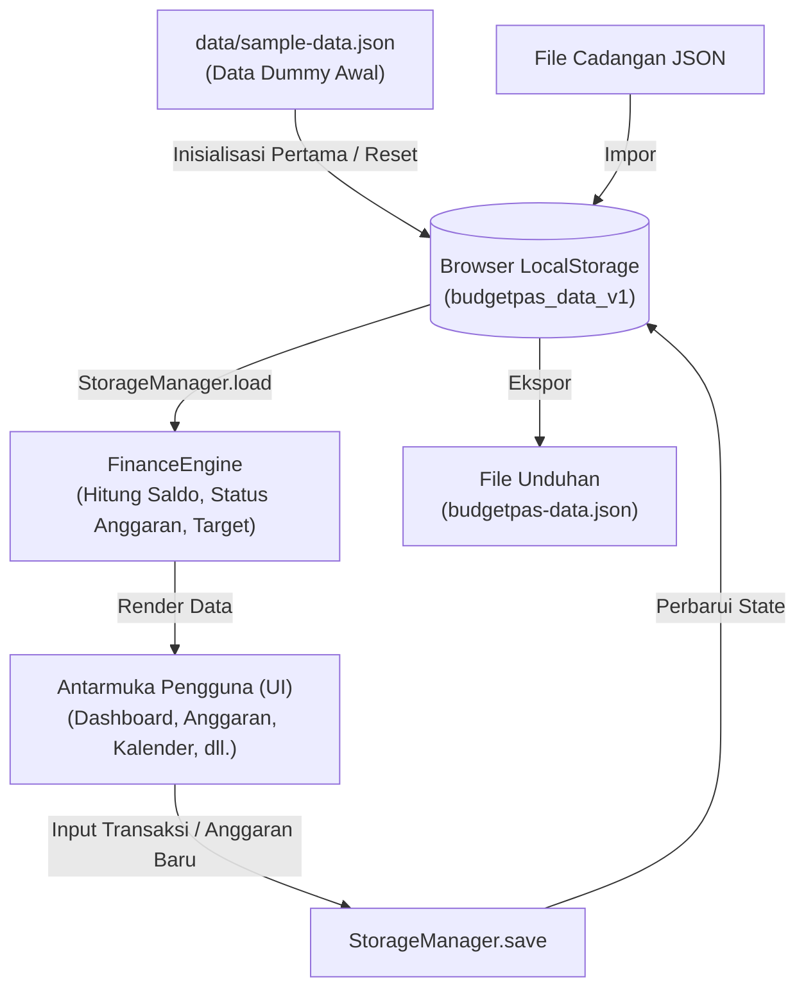

<div align="center">

# ▣ BudgetPas
### **Smart Financial Management for Students**
*Kelola keuangan, raih masa depan. Mulai dari kebiasaan kecil hari ini.*

[](https://developer.mozilla.org/en-US/docs/Web/HTML)
[](https://developer.mozilla.org/en-US/docs/Web/CSS)
[](https://developer.mozilla.org/en-US/docs/Web/JavaScript)
[](https://www.chartjs.org/)
[](https://developer.mozilla.org/en-US/docs/Web/API/Window/localStorage)
[](LICENSE)

<br>

**Prototipe Pure Web Application (Multi-Page Architecture)**  
*Dibuat untuk membantu mahasiswa kos mengatur uang bulanan secara terstruktur, transparan, dan terbebas dari krisis akhir bulan.*

[Fitur Utama](#-fitur-utama-sesuai-prd) • [Cara Menjalankan](#-cara-menjalankan-langsung) • [Struktur Proyek](#-struktur-berkas-proyek) • [Arsitektur Kode](#-arsitektur-kode--aliran-data) • [Deploy ke GitHub Pages](#-deploy-ke-github-pages-gratis)

</div>

---

## 📖 Daftar Isi
- [Latar Belakang & Masalah](#-latar-belakang--masalah)
- [Solusi yang Ditawarkan](#-solusi-yang-ditawarkan)
- [Fitur Utama (Sesuai PRD)](#-fitur-utama-sesuai-prd)
- [Teknologi yang Digunakan](#-teknologi-yang-digunakan)
- [Cara Menjalankan (Langsung)](#-cara-menjalankan-langsung)
- [Struktur Berkas Proyek](#-struktur-berkas-proyek)
- [Arsitektur Kode & Aliran Data](#-arsitektur-kode--aliran-data)
- [Deploy ke GitHub Pages (Gratis)](#-deploy-ke-github-pages-gratis)
- [Desain & Tipografi](#-desain--tipografi)
- [Lisensi & Penulis](#-lisensi--penulis)

---

## 📌 Latar Belakang & Masalah

Mahasiswa, khususnya mahasiswa yang tinggal di kos, umumnya memiliki anggaran uang saku bulanan yang terbatas. Namun, aktivitas harian seperti makan, transportasi, print tugas kuliah, fotokopi modul, jajan santai, dan nongkrong sering kali tidak tercatat secara rapi.

Beberapa permasalahan utama yang sering dialami:
1. **Buta Arus Kas:** Mahasiswa kesulitan mengetahui sisa uang riil yang masih bisa dibelanjakan.
2. **Tanpa Batas Kategori:** Pengeluaran hiburan sering kali tanpa sadar memakan jatah makan pokok dan kebutuhan akademik.
3. **Kebocoran Pengeluaran Kecil:** Uang parkir, jajan sore, atau kopi kekinian yang tampak sepele terakumulasi menjadi nominal besar.
4. **Tanpa Pengingat Anggaran:** Tidak ada sistem peringatan dini ketika anggaran suatu pos sudah hampir habis.
5. **Kesulitan Menabung:** Uang bulanan habis sebelum sempat disisihkan untuk dana darurat atau impian masa depan.

---

## 💡 Solusi yang Ditawarkan

**BudgetPas** menghadirkan solusi berupa aplikasi web yang sederhana, cepat, dan praktis:
- **Zero-Setup Pure Web App:** Tanpa perlu install server backend, virtual environment, atau konfigurasi database.
- **Client-Side Persistence:** Menggunakan **LocalStorage API** dan format **JSON** standar. Data aman tersimpan langsung di browser pengguna tanpa biaya server.
- **7 Modul Lengkap Sesuai PRD:** Dashboard finansial, anggaran kategori dinamis, pencatatan transaksi harian, laporan visual interaktif, pengingat otomatis (*threshold rule*), target tabungan, dan kalender aktivitas keuangan.

---

## 🎯 Fitur Utama (Sesuai PRD)

### 1. 📊 Dashboard Keuangan
* **4 Kartu Metrik Ringkasan:** Menampilkan *Uang Masuk*, *Total Pengeluaran*, *Sisa Uang (Saldo = Pemasukan − Pengeluaran)*, dan jumlah *Target Tabungan*.
* **Doughnut Chart (Chart.js):** Visualisasi proporsi pengeluaran per kategori secara *real-time* lengkap dengan total nominal di tengah grafik.
* **Ringkasan Anggaran:** Memantau 5 kategori anggaran utama beserta progres bar pemakaian.
* **Transaksi Terakhir:** Daftar transaksi terbaru dengan penanda visual panah pemasukan (↗ hijau) dan pengeluaran (↘ merah).
* **Tips Keuangan Mahasiswa:** Edukasi finansial praktis untuk kebiasaan hemat sehari-hari.

### 2. ▦ Anggaran Bulanan
* Tiga kartu ringkasan: *Total Anggaran*, *Total Terpakai*, dan *Sisa Anggaran*.
* Atur batas pengeluaran per kategori (*Makan, Transportasi, Kuliah, Hiburan, Tabungan, Kos, Laundry, dll.*).
* Dilengkapi *color picker* dan *palette swatch* untuk mengatur warna identitas setiap kategori.
* Menghitung sisa nominal dan persentase penggunaan secara dinamis.

### 3. ↕ Catat Transaksi (Pemasukan & Pengeluaran)
* Tombol beralih instan: **↘ Pengeluaran** atau **↗ Pemasukan**.
* Pemilihan tanggal fleksibel (otomatis terisi tanggal hari ini).
* Dropdown kategori dinamis yang tersinkronisasi otomatis dengan anggaran aktif.
* Format otomatis mata uang Rupiah (`Rp`) saat mengetik angka.
* Kolom catatan/keterangan transaksi opsional.
* Riwayat transaksi lengkap dengan **pencarian teks**, **filter jenis transaksi**, serta **tombol hapus** dengan konfirmasi dialog.

### 4. ▥ Laporan Pengeluaran
* **Bar Chart Pengeluaran per Kategori:** Grafik batang terurut dari alokasi pengeluaran terbesar.
* **Rincian Persentase:** Menampilkan persentase kontribusi setiap pos terhadap total pengeluaran.
* **Line Chart Tren Bulanan:** Grafik garis pergerakan total pengeluaran dari bulan ke bulan (Agustus, September, Oktober).
* **Analisis Finansial Otomatis:** Sistem menganalisis kategori pengeluaran terbesar dan memberikan rekomendasi evaluasi.

### 5. ♧ Pengingat Anggaran (Threshold Alert System)
Menerapkan aturan evaluasi status otomatis sesuai **PRD Section 5.5**:

| Persentase Pemakaian | Status Sistem | Penanda Warna | Arti Kondisi |
|---|---|---|---|
| **< 80%** | **Aman** | 🟢 Hijau | Pengeluaran masih berada dalam batas wajar |
| **80% – 99%** | **Hampir Habis** | 🟡 Kuning | Peringatan dini! Anggaran pos sudah menipis |
| **≥ 100%** | **Melebihi Anggaran** | 🔴 Merah | Bahaya! Pengeluaran telah melampaui batas anggaran |

* Dilengkapi banner dinamis (*alert banner*) di bagian atas yang otomatis menghitung berapa banyak pos pengeluaran yang butuh perhatian segera.

### 6. ◎ Target Tabungan
* Menentukan target tujuan finansial (*Dana Darurat, Laptop Skripsi, Liburan Semester*).
* Menentukan nominal target dan tenggat waktu pencapaian (*deadline*).
* Tombol inline `＋ Tambah Tabungan` langsung pada kartu target untuk menyicil tabungan.
* Rumus progres:  
  $$\text{Progres (\%)} = \min\left(100\%, \left(\frac{\text{Jumlah Tabungan}}{\text{Target Tabungan}}\right) \times 100\%\right)$$
* Otomatis berstatus **(Tercapai!)** ketika nominal target terpenuhi.

### 7. 📅 Kalender Keuangan
* Tampilan kalender bulanan interaktif dengan tombol navigasi `‹`, `Hari Ini`, dan `›`.
* Penanda visual otomatis pada tanggal transaksi:
  - 🟢 **Titik Hijau:** Menandai adanya transaksi pemasukan pada tanggal tersebut.
  - 🔴 **Titik Merah:** Menandai adanya transaksi pengeluaran pada tanggal tersebut.
  - 🎯 **Aksen Hijau:** Menandai tanggal hari ini.
* **Interaktivitas Klik Tanggal:** Klik tanggal mana saja pada kalender untuk melihat rincian aktivitas transaksi, total uang masuk, dan total uang keluar pada tanggal tersebut.

### 8. ⚙️ Pengaturan & Manajemen Data
* **Ubah Profil Mahasiswa:** Mengubah nama mahasiswa, status perkuliahan, dan referensi uang saku bulanan.
* **📥 Ekspor Data (JSON):** Mengunduh seluruh data (transaksi, anggaran, target, profil) ke berkas `.json` lokal.
* **📤 Impor Data (JSON):** Memulihkan data dari berkas backup JSON yang pernah diunduh.
* **↺ Reset ke Data Dummy:** Mengembalikan kondisi data kembali ke data simulasi awal mahasiswa (*Andi Pratama*) untuk keperluan demonstrasi atau pengujian ulang.
* **Kosongkan Data:** Menghapus seluruh data untuk mulai mencatat dari lembar kosong.

---

## 🛠 Teknologi yang Digunakan

Aplikasi ini dibangun murni menggunakan standar web modern tanpa *framework* yang rumit:

| Lapisan | Teknologi | Penjelasan |
|---|---|---|
| **Struktur** | **HTML5 Semantik** | Kerangka antarmuka berbasis Single Page Application (SPA) container |
| **Tampilan** | **CSS3 Modern** | CSS Variables, Flexbox, CSS Grid, responsive media queries |
| **Logika & Interaksi** | **Vanilla JavaScript (ES6+)** | Modul JavaScript bersih, modular, tanpa dependensi *build tool* (npm/webpack) |
| **Penyimpanan** | **Browser LocalStorage & JSON** | Penyimpanan data persisten di sisi klien (*client-side cache*) |
| **Visualisasi** | **Chart.js (CDN)** | Grafik interaktif Doughnut, Bar, dan Line Chart |
| **Tipografi** | **Google Fonts** | `DM Sans` (keterbacaan antarmuka) & `Manrope` (angka & judul tebal) |

---

## 🚀 Cara Menjalankan (Langsung)

Aplikasi ini dirancang dengan prinsip **Zero Setup** — dapat langsung dicoba dalam hitungan detik:

### Opsi 1: Buka Langsung di Browser (Paling Cepat)
1. Unduh atau clone repositori ini:
   ```bash
   git clone https://github.com/username/BudgetPas.git
   ```
2. Buka folder `BudgetPas`.
3. Klik dua kali (*double click*) pada berkas **`index.html`**.
4. Aplikasi akan langsung berjalan di browser Anda (Google Chrome, Microsoft Edge, Mozilla Firefox, Safari, dll.).

### Opsi 2: Menggunakan VS Code Live Server
1. Buka folder `BudgetPas` di **Visual Studio Code**.
2. Pastikan ekstensi **Live Server** telah terpasang.
3. Klik kanan pada berkas `index.html` lalu pilih **"Open with Live Server"**.

### Opsi 3: Menggunakan Python HTTP Server (Opsional)
Jika Anda ingin menjalankan server lokal sederhana:
```bash
python -m http.server 5000
```
Buka alamat `http://localhost:5000` pada browser Anda.

---

## 📂 Struktur Berkas Proyek

Struktur proyek dipecah menjadi berkas HTML terpisah (*Multi-Page Architecture*) yang rapi dan mudah dipelajari:

```text
BudgetPas/
│
├── .gitignore           # Konfigurasi pengabaian berkas sementara Git
├── LICENSE              # Lisensi Open Source (MIT License)
├── README.md            # Dokumentasi lengkap & siap publikasi
│
├── index.html           # Halaman 1: Dashboard Keuangan
├── budgets.html         # Halaman 2: Anggaran Bulanan
├── transactions.html    # Halaman 3: Catat Transaksi (Pemasukan & Pengeluaran)
├── reports.html         # Halaman 4: Laporan Pengeluaran & Grafik
├── reminders.html       # Halaman 5: Pengingat Anggaran (<80%, 80-99%, >=100%)
├── goals.html           # Halaman 6: Target Tabungan
├── calendar.html        # Halaman 7: Kalender Aktivitas Keuangan
├── settings.html        # Halaman 8: Pengaturan, Profil & Ekspor/Impor JSON
├── dashboard.html       # Redirect helper ke index.html
│
├── css/
│   └── style.css        # Stylesheet terpusat, variabel warna, layout, dan responsivitas
│
├── js/
│   └── app.js           # Logika aplikasi modular terpusat (Storage, Finance, Chart, Calendar, UI)
│
└── data/
    └── sample-data.json # Data Dummy JSON acuan prototipe mahasiswa
```

---

## 🧠 Arsitektur Kode & Aliran Data

### Aliran Data (Data Flow Diagram)



### Modul-Modul di `js/app.js`

1. **`DUMMY_DATA` & `StorageManager`**  
   Menyediakan data acuan awal mahasiswa dan mengelola operasi baca-tulis ke `localStorage`. Dilengkapi fungsi `exportJSON()`, `importJSON()`, serta `resetToDummy()`.
2. **`Formatters`**  
   Menyediakan fungsi pembantu format mata uang Rupiah (`Formatters.rupiah(val)`), tanggal lokal Indonesia (`Formatters.dateIndo(date)`), dan pemilihan emoji kategori.
3. **`FinanceEngine`**  
   Jantung kalkulasi matematis: menghitung total pemasukan, pengeluaran, saldo kas, persentase penggunaan per pos anggaran, klasifikasi status peringatan (<80%, 80%-99%, >=100%), dan progres capaian target tabungan.
4. **`ChartManager`**  
   Mengatur siklus hidup grafik Chart.js: membuat Doughnut Chart di Dashboard, Bar Chart dan Line Chart di Laporan, serta memastikan penghancuran (*destroy*) canvas lama saat data diperbarui agar tidak terjadi *glitch*.
5. **`CalendarManager`**  
   Menghitung jumlah hari, hari pertama dalam minggu, menghasilkan grid kalender dinamis, memetakan titik pemasukan/pengeluaran ke tanggal yang sesuai, dan menangani event klik detail tanggal.
6. **`UIManager` (Router & DOM Handler)**  
   Menerapkan Single Page Application (SPA) berbasis URL Hash (`#dashboard`, `#budgets`, dll.). Menangani event submit form, filter pencarian tabel, update breadcrumb, dan menampilkan animasi *Toast Notification*.

---

## 🌐 Deploy ke GitHub Pages (Gratis)

Aplikasi ini 100% siap di-*hosting* secara gratis di **GitHub Pages** tanpa konfigurasi server:

1. Buat repositori baru di GitHub dengan nama `BudgetPas`.
2. Unggah seluruh isi folder proyek ke repositori tersebut:
   ```bash
   git init
   git add .
   git commit -m "feat: initial release of BudgetPas Pure Web App"
   git branch -M main
   git remote add origin https://github.com/username/BudgetPas.git
   git push -u origin main
   ```
3. Di halaman repositori GitHub, buka tab **Settings** ➔ **Pages**.
4. Pada bagian **Build and deployment**, pilih Source: **Deploy from a branch**.
5. Pilih branch **`main`** dan folder **`/(root)`**, lalu klik **Save**.
6. Dalam beberapa menit, website Anda sudah aktif dan dapat diakses publik di:
   ```text
   https://username.github.io/BudgetPas/
   ```

---

## 🎨 Desain & Tipografi

Mengacu pada panduan desain PRD Section 7.1:

* **Hijau Tua (`#063F35`):** Sidebar dan identitas brand utama BudgetPas.
* **Hijau Utama (`#128568`):** Tombol aksi utama, progres aktif, dan transaksi pemasukan.
* **Hijau Muda (`#E8F5EF` / `#D7F4E8`):** Latar belakang kartu informasi dan badge status aman.
* **Merah (`#DC5964`):** Transaksi pengeluaran dan status bahaya anggaran (≥ 100%).
* **Kuning / Oranye (`#F0A52B`):** Status peringatan waspada anggaran hampir habis (80% – 99%).
* **Biru (`#357FD6`):** Saldo net dan kartu target tabungan.
* **Tipografi:** Google Fonts `DM Sans` untuk kenyamanan membaca teks dan `Manrope` untuk angka nominal dan judul tebal.

---

## 📄 Lisensi & Penulis

Proyek ini dirilis di bawah lisensi [MIT License](LICENSE) — bebas digunakan, dipelajari, dan dikembangkan untuk keperluan akademik maupun portofolio pribadi.

<div align="center">

Dibuat dengan ❤️ untuk mahasiswa yang ingin mengelola keuangan lebih bijak.  
**BudgetPas — Kelola keuangan, raih masa depan.**

</div>
