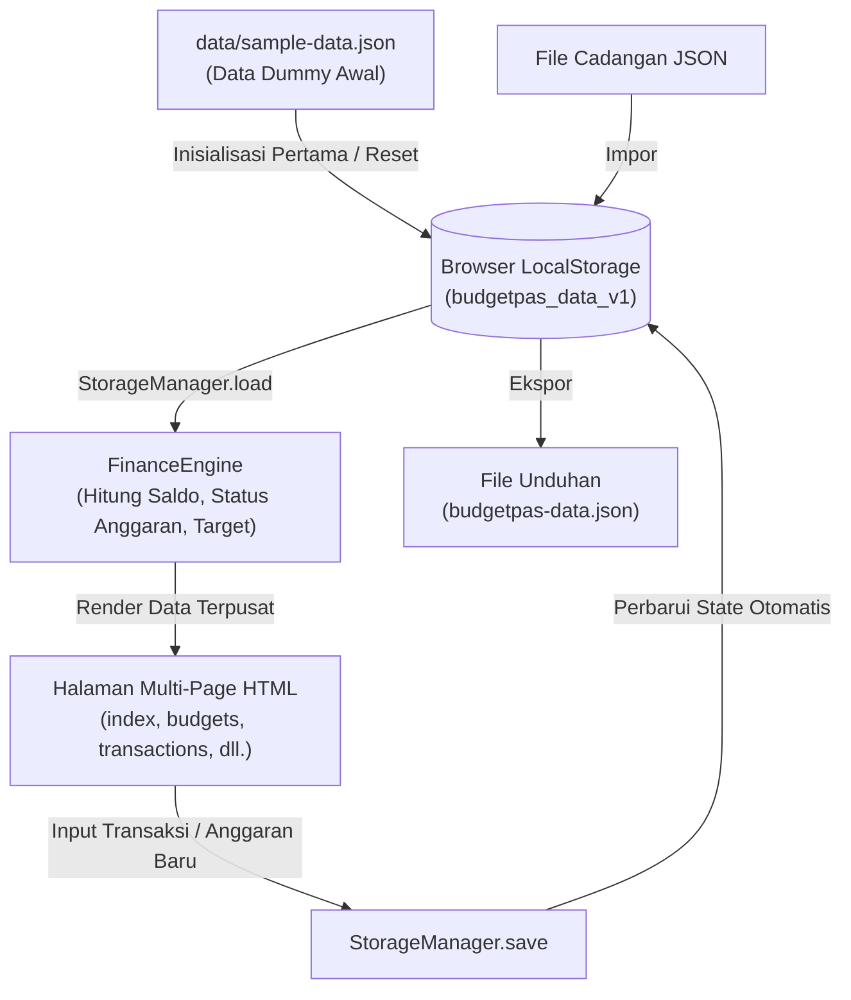

<div align="center">

# ▣ BudgetPas
### **Smart Financial Management for Students**
*Kelola keuangan, raih masa depan. Mulai dari kebiasaan kecil hari ini.*

[](https://developer.mozilla.org/en-US/docs/Web/HTML)
[](https://developer.mozilla.org/en-US/docs/Web/CSS)
[](https://developer.mozilla.org/en-US/docs/Web/JavaScript)
[](https://www.chartjs.org/)
[](https://developer.mozilla.org/en-US/docs/Web/API/Window/localStorage)
[](https://developer.mozilla.org/en-US/docs/Learn/HTML)
[](LICENSE)

<br>

**Prototipe Pure Web Application (Multi-Page Architecture)**  
*Aplikasi web pengelolaan keuangan pribadi yang dirancang khusus untuk membantu mahasiswa kos mengatur uang bulanan secara terstruktur, transparan, dan terbebas dari masalah kehabisan uang di akhir bulan.*

[Fitur Utama](#-fitur-utama-sesuai-prd) • [Daftar Halaman](#-daftar-halaman-aplikasi) • [Cara Menjalankan](#-cara-menjalankan-langsung) • [Struktur Proyek](#-struktur-berkas-proyek) • [Arsitektur & Data](#-arsitektur-kode--aliran-data) • [Deploy GitHub Pages](#-deploy-ke-github-pages-gratis)

</div>

---

## 📖 Daftar Isi
- [Latar Belakang & Masalah](#-latar-belakang--masalah)
- [Solusi yang Ditawarkan](#-solusi-yang-ditawarkan)
- [Fitur Utama (Sesuai PRD)](#-fitur-utama-sesuai-prd)
- [Daftar Halaman Aplikasi](#-daftar-halaman-aplikasi)
- [Teknologi yang Digunakan](#-teknologi-yang-digunakan)
- [Cara Menjalankan (Langsung)](#-cara-menjalankan-langsung)
- [Struktur Berkas Proyek](#-struktur-berkas-proyek)
- [Arsitektur Kode & Aliran Data](#-arsitektur-kode--aliran-data)
- [Deploy ke GitHub Pages (Gratis)](#-deploy-ke-github-pages-gratis)
- [Desain & Tipografi](#-desain--tipografi)
- [Lisensi & Penulis](#-lisensi--penulis)

---

## 📌 Latar Belakang & Masalah

Mahasiswa, khususnya mahasiswa yang tinggal di rumah kos, umumnya memiliki anggaran uang saku bulanan yang terbatas. Namun, kebutuhan harian seperti makan, transportasi, fotokopi modul kuliah, beli buku, jajan sore, hingga nongkrong santai sering kali tidak tercatat secara rapi.

Beberapa permasalahan utama yang kerap dihadapi:
1. **Buta Arus Kas:** Mahasiswa tidak mengetahui persis berapa sisa uang riil yang masih aman untuk dibelanjakan.
2. **Tanpa Batas Kategori:** Pengeluaran hiburan dan jajan sering kali tanpa sadar menggerus jatah makan pokok dan kebutuhan akademik.
3. **Kebocoran Pengeluaran Kecil:** Biaya parkir, air mineral, atau jajan ringan yang terkesan sepele ternyata terakumulasi menjadi nominal yang sangat besar di akhir bulan.
4. **Tanpa Pengingat Anggaran:** Tidak adanya alarm atau peringatan dini saat kuota pengeluaran untuk suatu pos kebutuhan sudah hampir habis.
5. **Sulit Menabung:** Uang bulanan habis sebelum sempat disisihkan untuk tabungan masa depan atau dana darurat.

---

## 💡 Solusi yang Ditawarkan

**BudgetPas** menghadirkan solusi digital yang sederhana, ringan, dan praktis:
- **Zero-Setup Pure Web App:** Berjalan 100% langsung di browser tanpa instalasi backend Python/Flask, dependensi pip, atau database SQLite yang rumit.
- **Client-Side Persistence:** Menggunakan **LocalStorage API** dan format **JSON** standar. Data tersimpan aman langsung di perangkat pengguna secara persisten dan cepat.
- **Multi-Page Architecture:** Setiap fitur memiliki berkas HTML tersendiri yang rapi, modular, dan mudah dipelajari oleh mahasiswa maupun pengembang pemula.
- **Sinkronisasi Data Otomatis:** Perubahan data pada satu halaman (misal: tambah transaksi) langsung otomatis menyinkronkan saldo, grafik, dan anggaran di seluruh halaman lainnya.

---

## 🎯 Fitur Utama (Sesuai PRD)

### 1. 📊 Dashboard Keuangan
* **4 Kartu Metrik Utama:** Menampilkan *Uang Masuk*, *Total Pengeluaran*, *Sisa Uang (Saldo = Pemasukan − Pengeluaran)*, dan jumlah *Target Tabungan*.
* **Doughnut Chart (Chart.js):** Visualisasi proporsi pengeluaran per kategori secara *real-time* dengan total pengeluaran tertera di tengah diagram.
* **Ringkasan Anggaran:** Memantau 5 pos anggaran teratas beserta progres bar pemakaian.
* **Transaksi Terakhir:** Menampilkan 6 transaksi terbaru lengkap dengan penanda visual panah pemasukan (↗ hijau) dan pengeluaran (↘ merah).
* **Tips Finansial Mahasiswa:** Edukasi finansial harian untuk menumbuhkan kebiasaan hemat.

### 2. ▦ Anggaran Bulanan
* Tiga kartu ringkasan: *Total Anggaran*, *Total Terpakai*, dan *Sisa Anggaran*.
* Atur batas pengeluaran per kategori (*Makan, Transportasi, Kuliah, Hiburan, Tabungan, Kos, Laundry, dll.*).
* Dilengkapi *color picker* dan *palette swatch* untuk memilih warna identitas setiap kategori.
* Menghitung sisa nominal dan persentase penggunaan secara dinamis dengan progres bar interaktif.

### 3. ↕ Catat Transaksi (Pemasukan & Pengeluaran)
* Tombol beralih cepat: **↘ Pengeluaran** atau **↗ Pemasukan**.
* Input tanggal transaksi (otomatis terisi tanggal hari ini).
* Pilihan kategori dinamis yang tersinkronisasi otomatis dengan pos anggaran yang aktif.
* Auto-formatting mata uang Rupiah (`Rp`) saat mengetik angka nominal.
* Kolom catatan/keterangan transaksi opsional.
* Riwayat transaksi lengkap dengan **pencarian teks**, **filter jenis transaksi**, serta **tombol hapus** dengan konfirmasi dialog.

### 4. ▥ Laporan Pengeluaran
* **Bar Chart Pengeluaran per Kategori:** Diagram batang terurut otomatis dari pos pengeluaran nominal terbesar.
* **Rincian Persentase:** Menampilkan persentase kontribusi setiap kategori terhadap total pengeluaran.
* **Line Chart Tren Bulanan:** Grafik garis pergerakan total pengeluaran dari bulan ke bulan (Agustus, September, Oktober).
* **Analisis Finansial Otomatis:** Sistem mengevaluasi pos pengeluaran terbesar dan memberikan saran penghematan.

### 5. ♧ Pengingat Anggaran (Threshold Alert System)
Menerapkan aturan evaluasi status otomatis sesuai **PRD Section 5.5**:

| Persentase Pemakaian | Status Sistem | Penanda Warna | Arti Kondisi |
|---|---|---|---|
| **< 80%** | **Aman** | 🟢 Hijau | Pengeluaran masih berada dalam batas wajar |
| **80% – 99%** | **Hampir Habis** | 🟡 Kuning | Peringatan dini! Anggaran pos sudah mulai menipis |
| **≥ 100%** | **Melebihi Anggaran** | 🔴 Merah | Bahaya! Pengeluaran telah melampaui batas anggaran |

* Dilengkapi banner dinamis (*alert banner*) di bagian atas yang otomatis memberitahu jumlah pos pengeluaran yang butuh perhatian segera.

### 6. ◎ Target Tabungan
* Menentukan target finansial (*Dana Darurat, Laptop Skripsi, Liburan Semester*).
* Menentukan nominal target dan tenggat waktu pencapaian (*deadline*).
* Tombol inline `＋ Tambah Tabungan` langsung pada kartu target untuk menyicil tabungan kapan saja.
* Rumus progres:  
  $$\text{Progres (\%)} = \min\left(100\%, \left(\frac{\text{Jumlah Tabungan}}{\text{Target Tabungan}}\right) \times 100\%\right)$$
* Otomatis ditandai **(Tercapai!)** ketika nominal target terpenuhi.

### 7. 📅 Kalender Keuangan
* Tampilan kalender bulanan interaktif dengan kontrol navigasi `‹`, `Hari Ini`, dan `›`.
* Penanda visual otomatis pada tanggal transaksi:
  - 🟢 **Titik Hijau:** Menandai adanya transaksi pemasukan pada tanggal tersebut.
  - 🔴 **Titik Merah:** Menandai adanya transaksi pengeluaran pada tanggal tersebut.
  - 🎯 **Aksen Hijau:** Menandai tanggal hari ini.
* **Interaktivitas Klik Tanggal:** Klik tanggal mana saja pada kalender untuk melihat rincian aktivitas transaksi, total uang masuk, dan total uang keluar pada hari itu, lengkap dengan tombol cepat *Catat di tanggal ini*.

### 8. ⚙️ Pengaturan & Manajemen Data
* **Ubah Profil Mahasiswa:** Mengubah nama mahasiswa, status perkuliahan, dan referensi uang saku bulanan.
* **📥 Ekspor Data (JSON):** Mengunduh seluruh data (transaksi, anggaran, target, profil) ke berkas `.json` lokal sebagai backup.
* **📤 Impor Data (JSON):** Memulihkan data dari berkas backup JSON yang pernah diunduh.
* **↺ Reset ke Data Dummy:** Mengembalikan kondisi data kembali ke data simulasi awal mahasiswa (*Andi Pratama*) untuk keperluan demonstrasi atau pengujian ulang.
* **Kosongkan Data:** Menghapus seluruh data untuk mulai mencatat dari awal.

---

## 📑 Daftar Halaman Aplikasi

Aplikasi dipecah menjadi berkas HTML terpisah yang saling terhubung:

| Halaman | Berkas HTML | Deskripsi & Fungsi Utama |
|---|---|---|
| **Dashboard** | [`index.html`](index.html) | Ringkasan saldo, doughnut chart, anggaran, transaksi terkini, dan tips |
| **Anggaran Bulanan** | [`budgets.html`](budgets.html) | Alokasi batas anggaran per pos, progres bar, form tambah/edit anggaran |
| **Catat Transaksi** | [`transactions.html`](transactions.html) | Form input transaksi harian, tabel riwayat, fitur pencarian & filter |
| **Laporan** | [`reports.html`](reports.html) | Bar chart kategori, persentase rincian, line chart tren multi-bulan |
| **Pengingat** | [`reminders.html`](reminders.html) | Banner peringatan otomatis, evaluasi batas 80% dan 100% |
| **Target Tabungan** | [`goals.html`](goals.html) | Akumulasi tabungan, kartu target, progres capaian, form cicil tabungan |
| **Kalender** | [`calendar.html`](calendar.html) | Kalender aktivitas harian, titik penanda transaksi, detail per tanggal |
| **Pengaturan** | [`settings.html`](settings.html) | Edit profil, Ekspor JSON, Impor JSON, Reset Data Dummy, Kosongkan Data |
| **Redirect Helper** | [`dashboard.html`](dashboard.html) | Berkas pembantu yang otomatis mengarahkan ke `index.html` |

---

## 🛠 Teknologi yang Digunakan

| Komponen | Teknologi | Penjelasan |
|---|---|---|
| **Struktur** | **HTML5 Semantik** | Halaman-halaman modular terpisah (*Multi-Page Architecture*) |
| **Tampilan** | **CSS3 Modern** | CSS Variables, Flexbox, CSS Grid, responsif desktop & mobile |
| **Logika** | **Vanilla JavaScript (ES6+)** | Modular tanpa framework luar, bersih, mudah dipelajari |
| **Penyimpanan** | **Browser LocalStorage & JSON** | Data persisten di sisi klien (*client-side cache*) tanpa database server |
| **Visualisasi** | **Chart.js (CDN)** | Diagram Doughnut, Bar Chart, dan Line Chart interaktif |
| **Tipografi** | **Google Fonts** | `DM Sans` (kenyamanan membaca) & `Manrope` (angka & judul tebal) |

---

## 🚀 Cara Menjalankan (Langsung)

Aplikasi ini mengusung prinsip **Zero Setup** — dapat langsung dicoba dalam hitungan detik tanpa instalasi software tambahan:

### Opsi 1: Buka Langsung di Browser (Paling Cepat)
1. Unduh atau clone repositori ini:
   ```bash
   git clone https://github.com/Mighayate/BudgetPas.git
   ```
2. Buka folder `BudgetPas`.
3. Klik dua kali (*double click*) pada berkas **`index.html`**.
4. Aplikasi langsung berjalan di browser favorit Anda (Google Chrome, Microsoft Edge, Mozilla Firefox, Safari, dll.).

### Opsi 2: Menggunakan VS Code Live Server
1. Buka folder `BudgetPas` di **Visual Studio Code**.
2. Pastikan ekstensi **Live Server** sudah terpasang.
3. Klik kanan pada berkas `index.html` lalu pilih **"Open with Live Server"**.

### Opsi 3: Menggunakan Python HTTP Server (Opsional)
Jika ingin menjalankan server lokal sederhana:
```bash
python -m http.server 5000
```
Buka alamat `http://localhost:5000` pada browser Anda.

---

## 📂 Struktur Berkas Proyek

```text
BudgetPas/
│
├── .gitignore           # Konfigurasi pengabaian berkas sementara Git
├── LICENSE              # Lisensi Open Source (MIT License)
├── README.md            # Dokumentasi lengkap & siap publikasi
│
├── index.html           # Halaman 1: Dashboard Keuangan
├── budgets.html         # Halaman 2: Anggaran Bulanan
├── transactions.html    # Halaman 3: Catat Transaksi (Pemasukan & Pengeluaran)
├── reports.html         # Halaman 4: Laporan Pengeluaran & Grafik
├── reminders.html       # Halaman 5: Pengingat Anggaran (<80%, 80-99%, >=100%)
├── goals.html           # Halaman 6: Target Tabungan
├── calendar.html        # Halaman 7: Kalender Aktivitas Keuangan
├── settings.html        # Halaman 8: Pengaturan, Profil & Ekspor/Impor JSON
├── dashboard.html       # Redirect helper ke index.html
│
├── css/
│   └── style.css        # Stylesheet terpusat, variabel warna, layout, dan responsivitas
│
├── js/
│   └── app.js           # Logika aplikasi modular terpusat (Storage, Finance, Chart, Calendar, UI)
│
└── data/
    └── sample-data.json # Data Dummy JSON acuan prototipe mahasiswa
```

---

## 🧠 Arsitektur Kode & Aliran Data

### Aliran Data (Data Flow Diagram)



### Modul-Modul Utama di `js/app.js`

1. **`DUMMY_DATA` & `StorageManager`**  
   Menyediakan data acuan awal mahasiswa dan mengelola operasi baca-tulis ke `localStorage`. Dilengkapi fungsi `exportJSON()`, `importJSON()`, serta `resetToDummy()`.
2. **`Formatters`**  
   Fungsi pembantu untuk memformat nominal ke Rupiah (`Formatters.rupiah(val)`), format tanggal Indonesia (`Formatters.dateIndo(date)`), dan pencocokan emoji kategori.
3. **`FinanceEngine`**  
   Pusat kalkulasi finansial: menghitung saldo kas, agregasi pengeluaran per kategori, evaluasi batas pengingat (<80%, 80%-99%, ≥100%), dan progres capaian target tabungan.
4. **`ChartManager`**  
   Mengatur siklus hidup grafik Chart.js: membuat Doughnut Chart di Dashboard, Bar Chart dan Line Chart di Laporan, serta memastikan penghancuran (*destroy*) canvas lama sebelum render ulang agar memori efisien.
5. **`CalendarManager`**  
   Menghitung hari dalam bulan, menghasilkan grid kalender dinamis, memetakan titik pemasukan/pengeluaran ke tanggal terkait, dan menangani pemilihan tanggal.
6. **`UIManager` (Multi-Page Controller & DOM Handler)**  
   Mendeteksi halaman aktif via atribut `data-page` pada `<body>`, memberikan highlight aktif pada menu sidebar, menangani submit formulir, filter pencarian tabel, auto-formatting mata uang, integrasi query parameter URL (`?date=...`), dan animasi *Toast Notification*.

---

## 🌐 Deploy ke GitHub Pages (Gratis)

Aplikasi ini 100% siap di-*hosting* secara gratis di **GitHub Pages** tanpa konfigurasi server tambahan:

1. Pastikan seluruh berkas telah di-commit dan di-push ke GitHub:
   ```bash
   git add .
   git commit -m "feat: release BudgetPas Multi-Page Web App"
   git push origin main
   ```
2. Buka repositori Anda di GitHub: [`https://github.com/Mighayate/BudgetPas`](https://github.com/Mighayate/BudgetPas).
3. Klik tab **Settings** ➔ **Pages** (di menu sebelah kiri).
4. Pada bagian **Build and deployment**, pilih Source: **Deploy from a branch**.
5. Pilih branch **`main`** dan folder **`/(root)`**, lalu klik **Save**.
6. Dalam 1–2 menit, website Anda sudah aktif dan dapat diakses online di:
   ```text
   https://mighayate.github.io/BudgetPas/
   ```

---

## 🎨 Desain & Tipografi

Mengacu pada panduan desain PRD Section 7.1:

* **Hijau Tua (`#063F35`):** Sidebar dan identitas brand utama BudgetPas.
* **Hijau Utama (`#128568`):** Tombol aksi utama, progres aktif, dan transaksi pemasukan.
* **Hijau Muda (`#E8F5EF` / `#D7F4E8`):** Latar belakang kartu informasi dan badge status aman.
* **Merah (`#DC5964`):** Transaksi pengeluaran dan status bahaya anggaran (≥ 100%).
* **Kuning / Oranye (`#F0A52B`):** Status peringatan waspada anggaran hampir habis (80% – 99%).
* **Biru (`#357FD6`):** Saldo net dan kartu target tabungan.
* **Tipografi:** Google Fonts `DM Sans` untuk kenyamanan membaca teks dan `Manrope` untuk angka nominal dan judul tebal.

---

## 📄 Lisensi & Penulis

Proyek ini dirilis di bawah lisensi [MIT License](LICENSE) — bebas digunakan, dipelajari, dan dikembangkan untuk keperluan akademik maupun portofolio pribadi.

**Author:** [Kevin Adani (@Mighayate)](https://github.com/Mighayate)

<div align="center">

Dibuat dengan ❤️ untuk mahasiswa yang ingin mengelola keuangan lebih bijak.  
**BudgetPas — Kelola keuangan, raih masa depan.**

</div>